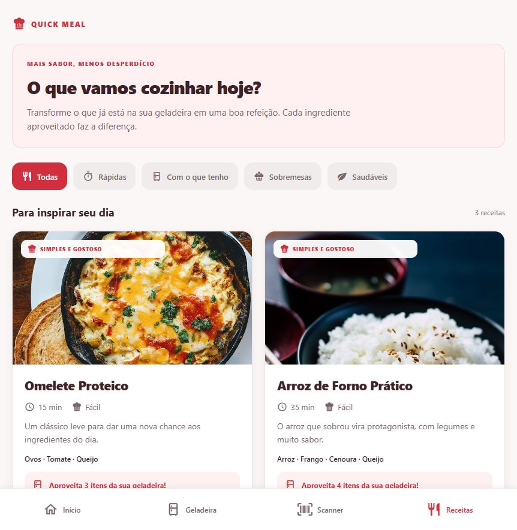
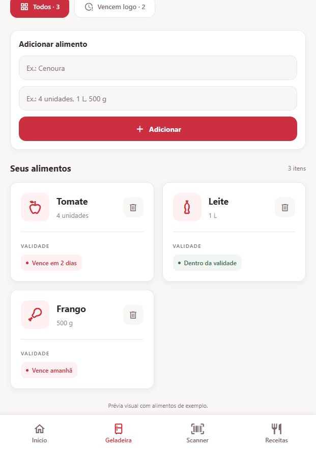
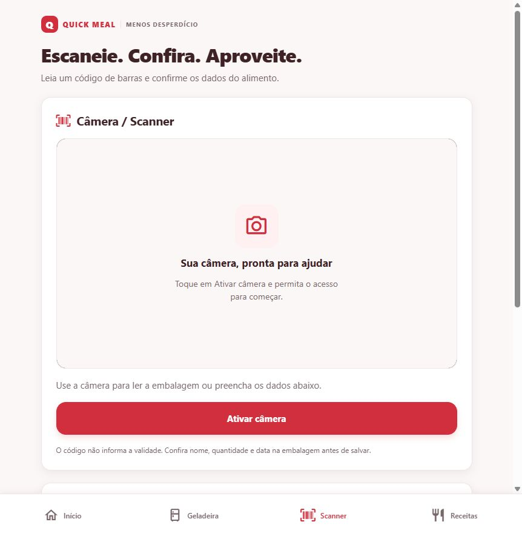

# Quick Meal

### Menos desperdício. Mais possibilidades à mesa.

<p align="center">
  
</p>

<p align="center">
  <a href="https://reactnative.dev/"></a>
  <a href="https://expo.dev/"></a>
  <a href="https://www.typescriptlang.org/"></a>
  
</p>

## Visão Geral

**Tecnologia para transformar os alimentos que você já tem em novas refeições.** O Quick Meal reúne uma geladeira virtual, leitura de códigos de barras e sugestões de receitas em uma experiência simples, moderna e conectada.

Desenvolvido com **React Native, Expo e TypeScript**, o aplicativo ajuda a organizar o estoque doméstico e a aproveitar ingredientes antes do vencimento.

## Autor

Desenvolvido por **Junior Temoteo**, estudante de Desenvolvimento de Sistemas e Desenvolvedor Júnior Full Stack.

- [LinkedIn](https://www.linkedin.com/in/junior-temoteo)
- [E-mail](mailto:juniortemoteo9@gmail.com)

> **Versão atual:** inventário compartilhado entre telas, persistência local e receitas demonstrativas com cruzamento real de ingredientes. Não é necessário ter conta, backend ou chave de API para começar. A integração com IA faz parte da evolução do projeto.

## O Problema e a Solução

Alimentos esquecidos e a dificuldade de decidir o que cozinhar contribuem para o desperdício doméstico. O Quick Meal permite registrar o que há na geladeira, acompanhar itens próximos do vencimento e encontrar receitas que aproveitam ingredientes disponíveis. Nesta versão, os dados ficam no dispositivo e o catálogo de receitas é demonstrativo.

## Demonstração

As imagens abaixo mostram telas do aplicativo. A captura de código registra o fluxo de leitura; a identificação automática do produto não faz parte da versão atual.

| Receitas | Geladeira | Scanner |
| --- | --- | --- |
|  |  |  |

---

## Funcionalidades Principais

### Geladeira Virtual Inteligente

- Cadastro rápido com nome e quantidade, incluindo medidas como `500 g`, `1 L` e `4 unidades`.
- Novos alimentos aparecem no topo da lista; a lixeira remove o cadastro correspondente.
- Cards com indicadores de validade e filtro para alimentos próximos do vencimento.
- Inventário único com **React Context + useState**, compartilhado entre Geladeira, Scanner, Dashboard e Receitas.
- Persistência com **AsyncStorage**, restauração ao abrir o app e migração dos dados da versão anterior.
- Alimentos de exemplo na primeira utilização para explorar a interface.

### Scanner de Câmera Nativo

- Visor ao vivo com `CameraView`, do **expo-camera**, e solicitação de permissão ao tocar em **Ativar câmera**.
- Moldura com cantos vermelhos e linha central para orientar o posicionamento do código de barras.
- Leitura de EAN-13, EAN-8, UPC-A, UPC-E e Code 128, conforme o suporte da plataforma.
- Formulário para conferir nome, quantidade e validade antes de **Salvar na geladeira**.
- Cadastro manual disponível quando o acesso à câmera não é permitido.
- Encerramento da câmera ao sair da aba ou colocar o aplicativo em segundo plano.

> **Efeito Laser Pulsante:** melhoria visual planejada. A implementação atual utiliza uma linha vermelha estática; ainda não há animação de pulsação.

O scanner captura o código de barras, mas não identifica automaticamente o produto ou sua validade. Na web, o acesso à câmera depende do navegador e das permissões do site.

### Feed Dinâmico de Receitas

- Catálogo inicial com **Omelete Proteico**, **Arroz de Forno Prático** e **Panqueca Rápida**.
- Cards com fotografia ilustrativa, ingredientes, tempo de preparo e dificuldade.
- Filtros horizontais: **Todas**, **Rápidas**, **Com o que tenho**, **Sobremesas** e **Saudáveis**.
- Cruzamento automático entre ingredientes das receitas e alimentos da geladeira.
- Comparação com `.toLowerCase()`, remoção de espaços nas extremidades e acentos, além de equivalências para alguns plurais comuns.
- Contador **“Aproveita X itens da sua geladeira!”** atualizado após cadastrar ou remover alimentos.
- Ingredientes repetidos contam apenas uma vez; alimentos com validade vencida são excluídos do cálculo.

O filtro **Com o que tenho** mostra receitas com pelo menos um ingrediente disponível. O contador indica ingredientes encontrados, sem garantir quantidade suficiente ou que a receita inteira possa ser preparada. As receitas são locais e não são geradas por IA nesta versão.

## Design System

A identidade visual combina **Vermelho e Branco** com fundos off-white e cores de apoio discretas. O vermelho destaca ações e informações importantes; o branco dá clareza aos cards, enquanto o fundo suave reduz o contraste visual excessivo.

Os tokens globais estão em [`src/theme/index.ts`](src/theme/index.ts):

| Elemento | Cor | Aplicação |
| --- | --- | --- |
| Vermelho principal | `#D12F3D` | Botões, ícones e destaques |
| Vermelho pressionado | `#AF1D2B` | Feedback de interação |
| Branco | `#FFFFFF` | Cards e texto sobre vermelho |
| Off-white | `#FAF7F6` | Fundo global |
| Vermelho suave | `#FFF1F2` | Áreas de destaque |
| Texto principal | `#3F2226` | Títulos e conteúdo |
| Texto secundário | `#79676A` | Legendas e informações complementares |

Geladeira e Receitas mantêm pequenas variações locais dessa paleta. Tons semânticos discretos complementam os indicadores de validade.

**Princípios de UI/UX:**

- Hierarquia visual com títulos fortes e informações secundárias suaves.
- Cards com bordas sutis, cantos arredondados de 14–16 e sombras leves.
- Espaçamento generoso e ícones do `MaterialCommunityIcons` alinhados aos textos.
- Layout responsivo com Flexbox e adaptação das colunas à largura disponível.
- Rótulos acessíveis, respeito às áreas seguras do aparelho e feedback de carregamento e erro.

## Tecnologias

| Tecnologia | Responsabilidade |
| --- | --- |
| React Native + Expo | Aplicativo para Android, iOS e web |
| TypeScript | Tipagem dos componentes, dados e contratos |
| Expo Router | Navegação por arquivos e quatro abas |
| React Context + useState | Inventário global compartilhado |
| AsyncStorage | Persistência local versionada |
| Expo Camera | Permissões, visor e leitura de códigos |
| Expo Vector Icons | Ícones consistentes na interface |

As versões utilizadas estão em [`package.json`](package.json); o [`package-lock.json`](package-lock.json) registra a resolução das dependências.

## Como Executar o Projeto

### Pré-requisitos

- **Node.js 22.13 ou superior**, conforme `package.json`, e npm.
- Projeto baixado ou clonado, com o terminal aberto na pasta raiz.
- Para celular: Expo Go compatível com o SDK do projeto ou um development build.
- Para emulação: Android Studio no Android; macOS e Xcode para o simulador iOS.

### Instalação e inicialização

```bash
npm install
npx expo start
```

Com o servidor iniciado, leia o QR code usando o Expo Go compatível. Para conexão pela rede local, mantenha o celular e o computador na mesma rede. No terminal do Expo, pressione `a` para Android, `i` para iOS ou `w` para web, conforme o ambiente disponível.

Também é possível iniciar diretamente:

```bash
npm run android
npm run ios
npm run web
```

Para uma instalação reproduzível a partir do lockfile, use `npm ci` no lugar de `npm install`.

**O `.env` é opcional nesta versão.** O inventário e o cruzamento de ingredientes funcionam localmente; as fotografias ilustrativas das receitas usam URLs externas e precisam de conexão para carregar.

### Validação e build web

```bash
npm run check       # TypeScript, ESLint e testes automatizados
npm run doctor      # Diagnóstico do ambiente Expo
npm run export:web  # Exportação de produção para a pasta dist
```

Os testes abrangem regras de estoque, validação, datas, persistência, migração e correspondência de ingredientes. O fluxo web permite conferir cadastro, remoção e atualização entre abas. Câmera e permissões nativas também devem ser verificadas em aparelhos Android/iOS.

## Estrutura do Projeto

```text
src/
├── app/
│   ├── _layout.tsx             # Provider global e navegação raiz
│   └── (tabs)/
│       ├── _layout.tsx         # Navegação das quatro abas
│       ├── index.tsx          # Dashboard
│       ├── fridge.tsx         # Geladeira conectada ao contexto
│       ├── scanner.tsx        # Scanner
│       └── recipes.tsx        # Feed e contadores dinâmicos
├── components/
│   └── ui.tsx                 # Componentes visuais reutilizáveis
├── context/
│   ├── FridgeContext.tsx      # FridgeProvider e useFridge
│   └── fridgeState.ts        # Tipos, dados iniciais e migração
├── features/
│   ├── dashboard/
│   ├── fridge/
│   ├── recipes/
│   │   └── matching.ts        # Correspondência de ingredientes
│   └── scanner/
└── theme/
    └── index.ts               # Tokens globais de estilo
```

O hook `useFridge()` disponibiliza `fridgeItems`, `addFoodItem` e `removeFoodItem`, além dos indicadores de restauração, erro de armazenamento e histórico de consumo. Cada alimento contém `id`, `name`, `quantity` e `isExpiring`; validade e código de barras são opcionais.

## Segurança e Boas Práticas

### Variáveis de ambiente

O projeto inclui [`.env.example`](.env.example) como referência para configurações futuras. Para criar sua configuração local, copie esse arquivo para `.env` na raiz:

```dotenv
EXPO_PUBLIC_API_URL=
```

Essa variável está reservada à URL pública de um futuro backend; a versão atual ainda não a utiliza para requisições.

O [`.gitignore`](.gitignore) já exclui `.env`, `.env.local`, `.env.production` e os demais arquivos `.env.*`, mantendo apenas `.env.example` versionado. Dependências, builds e arquivos de credenciais também são ignorados.

### Proteção de chaves de API

- **Nunca inclua chaves secretas de IA no aplicativo**, em `app.json` ou em variáveis `EXPO_PUBLIC_*`.
- Variáveis `EXPO_PUBLIC_*` são incorporadas ao bundle e podem ser lidas por quem usa o app.
- O `.gitignore` evita o versionamento acidental de arquivos locais; ele não torna secretos valores enviados no código compilado e não remove arquivos já rastreados pelo Git.
- Na futura integração com IA, mantenha as chaves em variáveis de ambiente do **backend** e exponha ao app somente os endpoints necessários, com autenticação e controle de acesso.
- Mantenha `.env.example` sem segredos e revise os arquivos antes de publicar commits.

### Dados e permissões

- O inventário fica no dispositivo, sem sincronização em nuvem nesta etapa. AsyncStorage não é um cofre para credenciais.
- A permissão da câmera é solicitada quando o usuário inicia a leitura.
- Os dados persistidos são validados na restauração, e as gravações são serializadas para preservar a ordem das alterações.
- Revise dependências e execute os checks do projeto antes de distribuir novas versões.

## Próximos Passos

- Adicionar o efeito de **laser pulsante** ao scanner.
- Integrar reconhecimento de alimentos e sugestões por IA através de um backend seguro.
- Evoluir a correspondência de ingredientes e a análise das quantidades disponíveis.
- Implementar notificações de validade e sincronização entre dispositivos.

## Licença

A licença de distribuição ainda será definida pelo mantenedor.

---

**Quick Meal — cada ingrediente aproveitado faz a diferença.**
